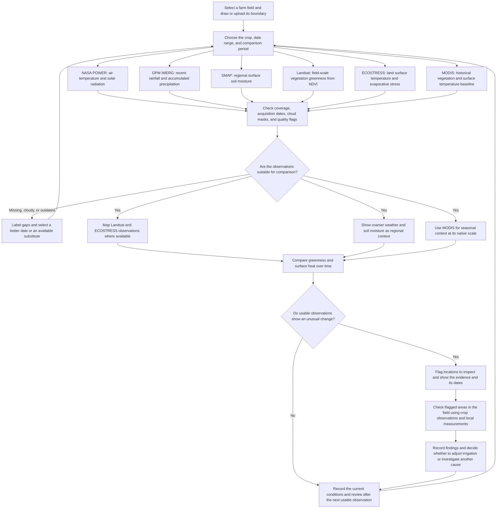

# Farm Monitoring Flowchart

NDVI is a measure of greenness. A drop in NDVI or a warm surface can help prioritize a field visit. Compare observations from similar growth stages and use field measurements to investigate the cause. SMAP and GPM grids can cover multiple fields, so display them as regional context.
